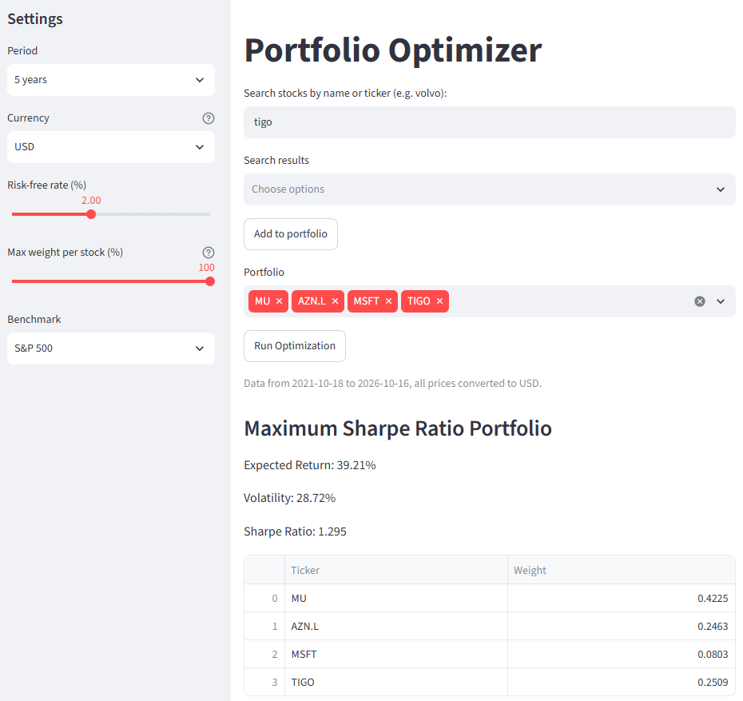

# Portfolio Optimizer

An interactive tool for portfolio optimization based on Modern Portfolio Theory (Markowitz). Given a set of stock/ETF tickers, it calculates the optimal asset allocation for maximizing risk-adjusted return (Sharpe ratio) or minimizing volatility, and lets users compare these against a manually weighted portfolio.

## Live Demo

[https://portfolio-optimizer-erbhuxdcgryfysc8gp3leh.streamlit.app/]

## Screenshot



## Features

- Search for stocks/ETFs by company name (e.g. "volvo") or enter a ticker directly
- Fetch historical price data for any combination of stocks/ETFs via Yahoo Finance
- Convert all prices to a common currency (SEK, USD or EUR) using daily exchange rates, so portfolios mixing markets include currency risk
- Handle different exchange holidays by carrying the last price forward instead of dropping days
- Choose the analysis period (1, 3, 5 or 10 years, or a custom date range)
- Calculate annualized expected returns and covariance matrix
- Find the portfolio with maximum Sharpe ratio using numerical optimization (scipy SLSQP)
- Find the minimum volatility portfolio
- Optional max weight per stock, to avoid optimized portfolios concentrated in one or two assets
- Compute and visualize the analytical efficient frontier
- Manually set custom portfolio weights (0.1% precision) and compare against the optimized portfolios
- Side-by-side comparison table (Return, Volatility, Sharpe Ratio) across all three strategies
- Historical buy-and-hold performance of each portfolio against a benchmark (OMXS30 or S&P 500)
- Local CSV caching and Streamlit caching to reduce redundant API calls and keep the UI responsive
- Error handling for invalid tickers, empty inputs, infeasible weight caps and failed optimizations

## How It Works

The tool implements Modern Portfolio Theory: given historical returns and the covariance between assets, it's possible to mathematically determine the asset weights that either maximize return per unit of risk (Sharpe ratio) or minimize total portfolio risk, subject to the constraint that weights sum to 1 and short-selling is not allowed.

Two complementary approaches are used. A Monte Carlo simulation generates thousands of random portfolios to visualize the risk/return space, while `scipy.optimize` (SLSQP method) solves for the exact optimal weights analytically — this becomes noticeably more accurate than Monte Carlo as the number of assets grows, since random sampling covers a shrinking fraction of the possible weight combinations in higher dimensions. The efficient frontier itself is computed by solving a constrained optimization problem (minimize volatility for a given target return) across a range of target returns.

The historical performance chart shows how 10,000 (in the chosen currency) invested on the first day would have developed in each portfolio. Note that the optimized portfolios are calculated from the same period, so the backtest is in-sample and flatters them compared to what could have been known in advance.

## Tech Stack

- **Python**
- **Streamlit** - interactive UI
- **yfinance** - historical price data
- **scipy** - numerical optimization (SLSQP)
- **pandas / numpy** - data processing and linear algebra
- **matplotlib** - efficient frontier visualization

## Project Structure

```
portfolio-optimizer/
├── app.py                   # Streamlit UI - entry point
├── requirements.txt
├── data/                     # Cached price data and currencies (gitignored)
└── src/
    ├── data_fetcher.py       # Data fetching, CSV caching, ticker search, currency conversion
    ├── returns.py             # Price → daily returns
    ├── portfolio_metrics.py   # Expected returns, covariance matrix, portfolio performance, backtest
    ├── monte_carlo.py         # Monte Carlo simulation (background visualization)
    ├── optimizer.py            # scipy.optimize: max Sharpe, min volatility, efficient frontier
    └── visualization.py       # matplotlib efficient frontier plot
```

## Running Locally

```powershell
git clone https://github.com/HenkeG23/Portfolio-optimizer.git
cd portfolio-optimizer
python -m venv venv
venv\Scripts\activate
pip install -r requirements.txt
streamlit run app.py
```

## What I Learned

- **yfinance's MultiIndex columns** silently break CSV caching if not flattened first — a good reminder that "it works on the first run" doesn't mean the pipeline is correct end-to-end.
- **Streamlit reruns the entire script on every interaction**, which means `st.button` alone doesn't persist state — `st.session_state` is required to keep results visible while the user adjusts other inputs (e.g. manual weight sliders).
- **Monte Carlo simulation is a good visual/intuitive tool but doesn't scale well** — with more assets, the gap between random sampling and true analytical optimization (scipy's SLSQP) grows quickly, since random points cover a shrinking fraction of a higher-dimensional weight space.
- **Separation of concerns pays off in practice**: keeping data fetching, calculations, optimization, and visualization in separate modules made debugging significantly easier, since each bug could be isolated to a single, small file.

## Author

Henrik Gidlund